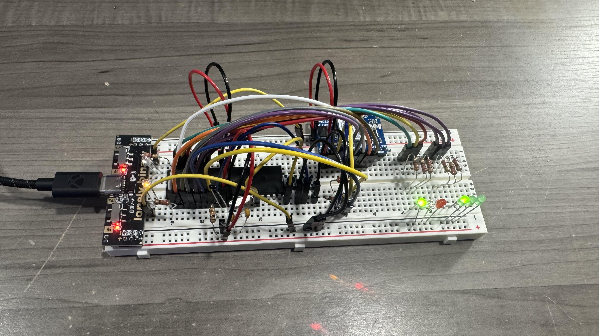
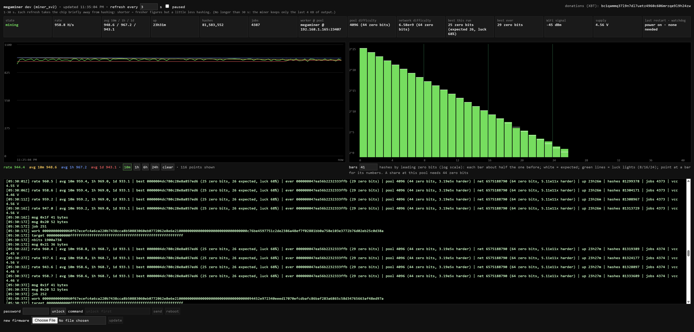
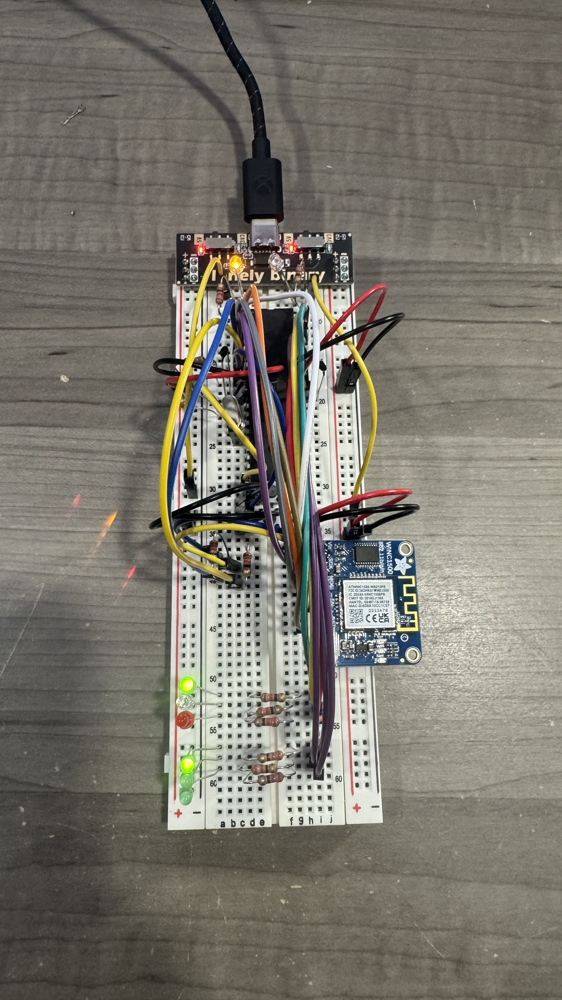
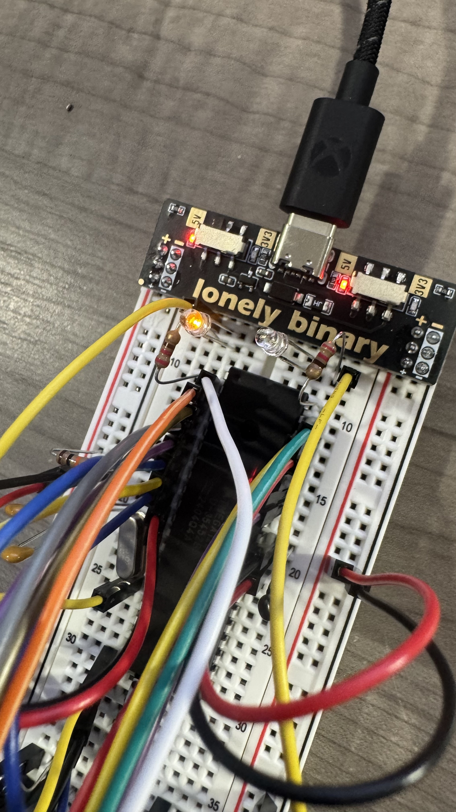
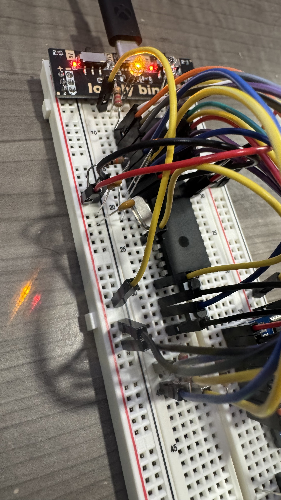
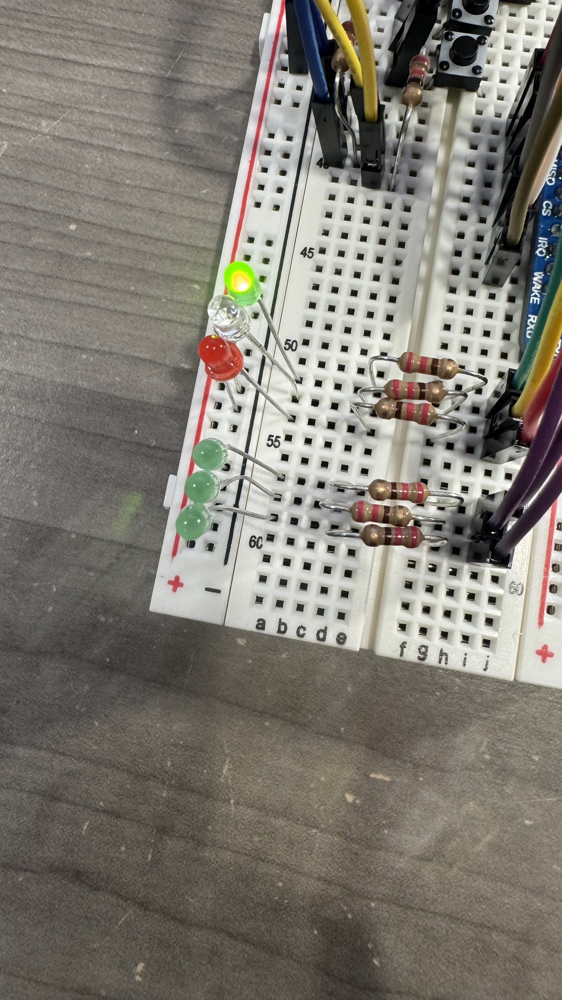
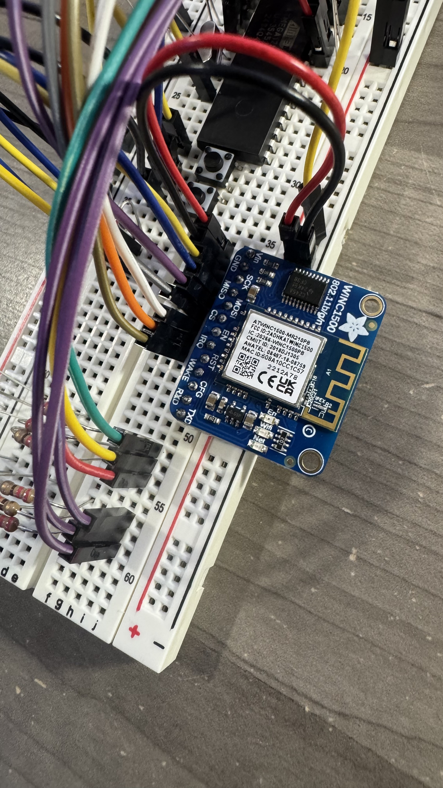
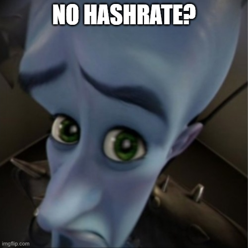

# megaminer

Runs on an ATmega chip, but nothing about it is mega.

<p align="center"></p>

A from-scratch toy miner for XBT on a bare ATmega1284P on a breadboard.
Plain C, no operating system, no Arduino. It joins WiFi, speaks Stratum V2
(Noise handshake, secp256k1, ChaCha20-Poly1305, all on an 8-bit chip) and
hashes at about 960 hashes per second.

The point is to see a general-purpose 8-bit chip do one specific job end to
end: from a blinking LED to live work from a real pool. At ~960 H/s, it is
not a way to reliably earn XBT from securing the network ([it really is not](#it-will-not-pay-for-itself)).

**Recommended: build it with an AI assistant at your side.** megaminer was
itself written with one, and that is also a good way to follow it. Give an
LLM this repository and have it walk you through the
[build sheet](docs/build.md) a step at a time, explain what a part or a fuse
does, or read a console log with you when something does not work. Before
anything that cannot be undone, such as writing fuses or applying power to
new wiring, check its advice against these documents and the datasheet.

## Documentation

- **[Build sheet](docs/build.md):** the parts list with part numbers, the
  wiring diagram, and a staged build with a check at each stage: power, the
  chip, the programmer, the crystal and fuses, the lights, the WiFi
  breakout, the first flash and the first settings.
- **[Manual](docs/manual.md):** how a built miner behaves and how to run it:
  the lights, the start-up button menu, the consoles and every command and
  setting, the web page, the log, firmware updates.
- **This README:** what it is, why it counts as real mining, building the
  firmware, and where the code lives.

## What it does

- **Hashing:** BLAKE2b over the 80-byte XBT work block, as generated AVR
  assembly (`tools/gen_blake2b_avr.py`). It does about 20,000 clock cycles
  per hash at 20 MHz, about 5x the speed of plain C.
- **Stratum V2** (`firmware/miner_sv2.c`, `sv2*.c`): My variant of SV2 for XBT,
  as the DATUM gateway defines it (that work is not public, _yet_). A
  `Noise_NX_Secp256k1+EllSwift_ChaChaPoly_SHA256` handshake; the pool's
  certificate is verified against its authority key, with a validity window
  checked against time from an SNTP server. The curve arithmetic is
  micro-ecc (vendored in `third_party/`). Making a key takes 4-12 s on the
  chip and the handshake about 12 s.
- **Stratum V1** (`firmware/miner_sv1.c`): the same miner for pools that
  speak SV1, such as a DATUM gateway's SV1 port. Everything except the
  protocol is shared (`firmware/miner.c`).
- **WiFi:** an ATWINC1500 breakout, driven by our own small driver
  (`firmware/net/winc.c`, `net_winc.c`). Its reference was Microchip's host
  driver.
- **Remote access:** a telnet console and a web page (live log, hash rate
  and luck charts, commands, firmware upload), with commands behind a
  console password.
- **Firmware over WiFi:** a bootloader in the chip's 8 KB boot section
  (`boot/boot.c`), sent to by `cmd/ota`. The image is CRC-checked after
  writing, and a half-written image is never started. A start-up button
  menu can clear the console password, start WiFi setup from a phone, or
  hold the chip in the bootloader.
- **Looking after itself:** a watchdog restarts the chip if the program
  stops for ~8 s or has not hashed for 15 minutes.
- **Lights:** a breathing heartbeat, a traffic light (hashing / on the way /
  needs you), a luck bar for rare hashes, and a telnet light.
- **Ethernet:** the earlier W5500 Ethernet backend (`ethernet/`, with its own
  DHCP client) still builds: `NET=w5500`. Programs talk to the network only
  through `firmware/net/net.h`, so either chip can be used.

The [manual](docs/manual.md) covers each of these in use.

Megaminer also hosts a web dashboard with rudimentary statistics tracking and
insights:

[](docs/images/dashboard.png)

## Is it really mining?

Yes. Every hash is a genuine XBT proof-of-work attempt on live work: with
(astronomical) luck the chip would find a block the network accepts. What
shows it:

- **Real blocks.** Early on, the chip solved regtest blocks that a Bitcoin
  Knots node accepted. The SV2 miner itself (`make sim`: the same C files,
  run on a PC to find shares faster) has had shares accepted by the DATUM
  gateway's own SV2, each one a regtest block the node accepted.
- **Reference vectors.** The BLAKE2b code passes RFC 7693 and Knots' own
  work-block test vector.
- **The fast routine cannot lie.** The assembly routine only screens nonces.
  A possible share is hashed again with the plain C BLAKE2b, the code that
  mined those blocks, and only that full digest decides what is sent. The
  chip compares the two routines at every start-up, and `make check` decodes
  the routine from the built firmware and checks the machine code against
  Python's hashlib.
- **Checkable work.** `tools/check_sv1_work.py` rebuilds every work block
  the SV1 miner logs from the pool's own messages.

## The hardware

<table>
<tr>
<td width="40%"></td>
<td>

From the top:

- **The USB-C power module**, feeding both power rails at 5 V.
- **The heartbeat light** (left, breathing) and **the telnet light**
  (right), either side of the chip's first and last pins.
- **The ATmega1284P** in the middle, under most of the jumpers, with the
  crystal beside it.
- **The WiFi breakout** (blue) on the right, wired to the chip's SPI pins.
- **The traffic light and the luck bar** at the bottom left, each through
  its 220 Ω resistor.

</td>
</tr>
</table>

<table>
<tr>
<td width="25%"></td>
<td width="25%"></td>
<td width="25%"></td>
<td width="25%"></td>
</tr>
<tr>
<td>The chip, the busiest part of the board: nearly every pin has a wire.</td>
<td>The same corner from the side: the 20 MHz crystal (silver) and its two 27 pF capacitors.</td>
<td>The traffic light (green: hashing) and the luck bar, dark until a rare hash.</td>
<td>The ATWINC1500 breakout: power and seven signal wires.</td>
</tr>
</table>

An ATmega1284P on a 20 MHz crystal, an Adafruit ATWINC1500 WiFi breakout,
eight LEDs and two buttons on one breadboard, powered by a USB-C breadboard
power module. A USBasp programmer is needed once, for the fuses and the
first flash; after that, firmware goes over WiFi. The parts, the wiring and
the fuses are all in the **[build sheet](docs/build.md)**.

## Building the firmware

Tools: GNU make, avr-gcc and avr-libc, avrdude (only for the first flash), a
PC gcc, Python 3, Go, and Node (only for `make check`). The Makefile works on
Windows, Linux and macOS, but do note this was primarily designed and tested
in a Windows environment. On Debian/Ubuntu:
`sudo apt install make gcc gcc-avr avr-libc avrdude python3 golang nodejs`.

```
make                             # build build/miner_sv2.hex (TARGET=miner_sv1 for SV1)
make size                        # flash / RAM use
make flash                       # first time: program + bootloader over the USBasp
make ota HOST=<miner address>    # every time after that, over WiFi
make check                       # every test, every build, the machine-code checks
make sim                         # both miners as PC programs
make clean                       # remove build/
```

Everything the build makes goes into `build/`. The Makefile never writes
fuses. `make check` runs the PC tests (BLAKE2b, the fast routine, the SV2
crypto and curve code, hash-rate maths, DHCP), the bootloader and WiFi code
compiled against a fake module, the web page's script under Node, every
firmware build, a check of the hashing machine code in the built programs,
and a check that `boot.c` still builds into the bootloader installed on the
chip (`boot/boot_installed.hex`; skipped with a different avr-gcc version).

`make sim` builds `build/miner_sv2_sim` and `build/miner_sv1_sim`: the miners
themselves (`miner.c` with the protocol file), with a stand-in for the
hardware, so they can be run against a real pool from a PC.

The firmware's version comes from git (`git describe --tags --always
--dirty`): `v0.1.0` when built at that tag, `v0.1.0-3-g1a2b3c4` three commits
later, with `-dirty` for uncommitted changes. It is printed at start-up and
by `help`, shown on the web page, and sent to the pool.

## Layout

| Path | What |
|---|---|
| `firmware/` | the miners: `miner.c` (everything but the protocol), `miner_sv2.c`, `miner_sv1.c`, and what they share |
| `firmware/net/` | the WiFi module's driver and the network side (console, web page) |
| `boot/` | the bootloader, its contract with the programs (`bootshare.h`) and the image installed on the chip |
| `ethernet/` | the W5500 Ethernet backend and the early bridge-era programs |
| `cmd/` | Go tools: `ota` (firmware sender), `bridge` (the early serial/TCP job bridge), test-vector generators |
| `docs/` | the build sheet, the wiring diagram and the manual |
| `tools/` | build helpers and checkers, and the wiring diagram's drawing script |
| `tests/` | PC tests, the PC simulator (`tests/sim`), and programs that test the chip itself (`tests/chip`: the SV2 crypto, and `winc_id`, which checks the WiFi module's wiring) |
| `third_party/micro-ecc` | elliptic-curve library (BSD 2-clause), with local fixes listed in `VENDORED.txt` |

## It will not pay for itself

megaminer will never earn back its parts, or even its electricity. At about
960 hashes per second, one share at difficulty 1 (2^32 hashes, the lowest
the DATUM gateway allows) takes about 52 days on average, and a block is so
far beyond that it is not worth working out. Do not build one to make money:
build one to see how a miner works, from the crystal to the pool.

<p align="center"></p>

## Donations

If megaminer is useful to you, donations are accepted at:
`bc1qammq37l9n7dl7uetz4960c606mrzqe9l9h24zw`

## License

MIT, see `LICENSE`.
