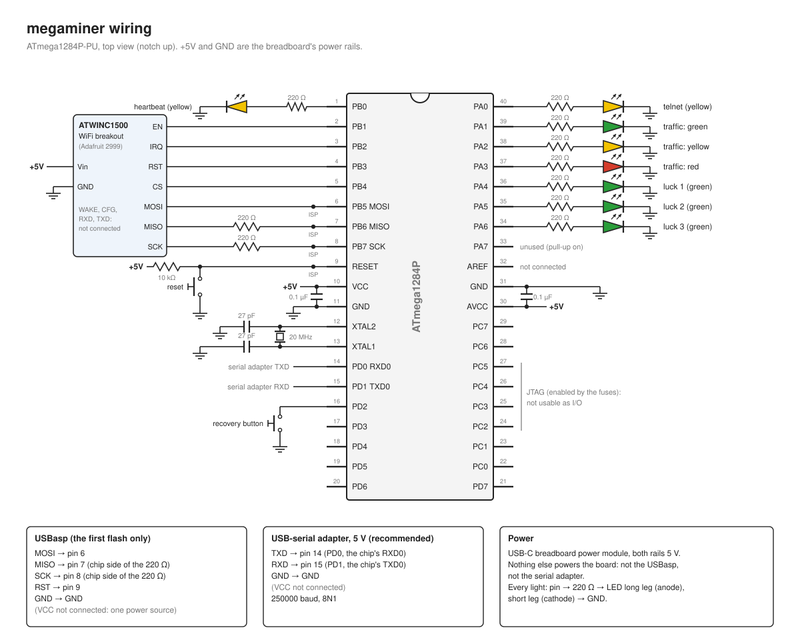
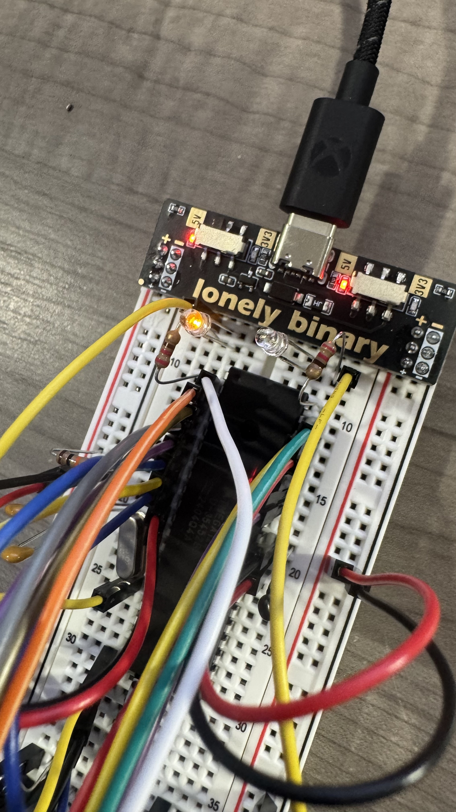
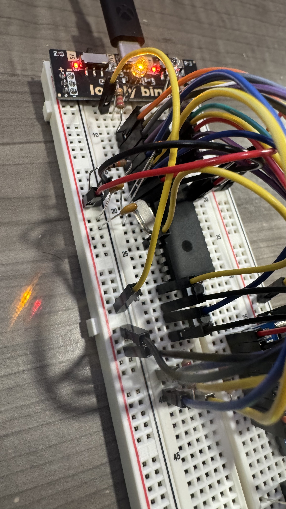
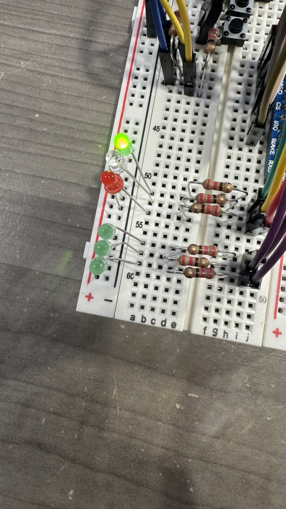
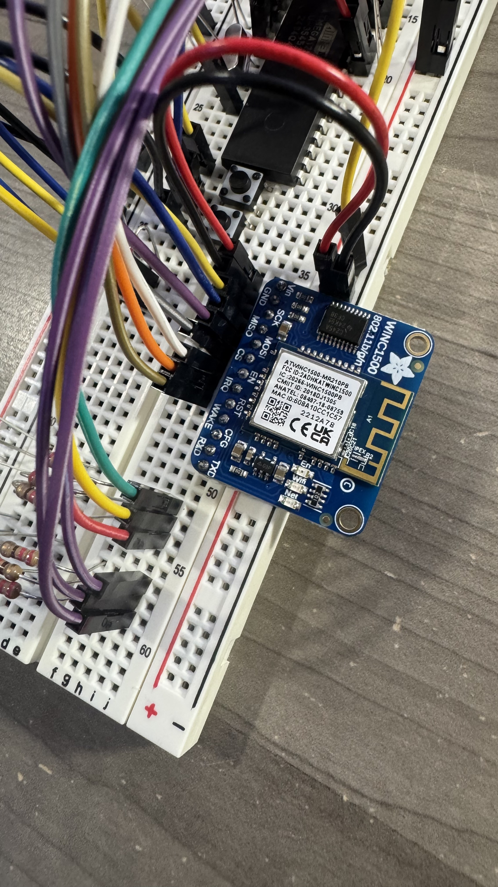

# Building a megaminer

Everything fits on one 830-point breadboard and runs from a USB port. The
build goes in stages, each with a check, so a mistake shows up while there
are only a few wires to look at.



(`tools/draw_wiring.py` draws the diagram.)

## Parts

| Qty | Part | What to look for | Used in the prototype | DigiKey |
|---|---|---|---|---|
| 1 | Microcontroller | ATmega1284P-PU (40-pin DIP) | Microchip ATMEGA1284P-PU | ATMEGA1284P-PU-ND |
| 1 | Crystal | 20 MHz, HC-49/US, 18 pF load | QST QT49-20.000MAAJ-B | 4981-QT49-20.000MAAJ-B-ND |
| 2 | Capacitor | 27 pF ceramic, C0G/NP0, radial leads | Vishay K270J15C0GF5TL2 | BC1006CT-ND |
| 2 | Capacitor | 0.1 µF ceramic, X7R, radial leads | Vishay K104K10X7RF53L2 | BC5137-ND |
| 1 | Resistor | 10 kΩ, 1/4 W | Stackpole CF14JT10K0 | CF14JT10K0CT-ND |
| 10 | Resistor | 220 Ω, 1/4 W (8 lights, 2 on the WiFi lines) | Stackpole CF14JT220R | CF14JT220RCT-ND |
| 3 | LED | yellow, 3 mm (5 mm works too) | Inolux INL-3AY30 | 1830-1002-ND |
| 4 | LED | green, 3 mm | Lite-On LTL-4231N | 160-1142-ND |
| 1 | LED | red, 3 mm | Lite-On LTL-4221 | 160-1877-ND |
| 2 | Push button | 6 mm tactile, through-hole | TE Connectivity 1825910-6 | 450-1650-ND |
| 1 | WiFi | ATWINC1500 breakout (has its own 3.3 V regulator and level shifting) | Adafruit 2999, [Mouser](https://www.mouser.com/ProductDetail/Adafruit/2999?qs=qrYS%2FWt5A15vPplJW%252BpOJw%3D%3D) | not at DigiKey: from Adafruit or Mouser |
| 1 | Serial adapter | USB-serial (UART) adapter that can do 5 V | DSD TECH SH-U09C5 (FTDI FT232RL), [Amazon](https://www.amazon.com/dp/B07WX2DSVB) | |
| 1 | Programmer | USBasp, with a 10-to-6-pin adapter; only for the fuses and the first flash | [Amazon](https://www.amazon.com/dp/B07NZ59VK2) | |
| 1 | Power | USB-C breadboard power module with 5 V output | [Amazon](https://www.amazon.com/dp/B0FXL6DLB9) | |
| 1 | Breadboard | 830 points | Adafruit 239 | 1528-239-ND |
| | Jumper wires | male-male, and male-female for the programmer and the serial adapter | SparkFun PRT-14284 (M-M 4"), Adafruit 1957 (M-M 6"), Adafruit 1954 (M-F 6") | 1568-14284-ND, 1528-1967-ND, 1528-1964-ND |

The prototype was built from exactly these parts: the DigiKey codes are
from its order. The WiFi breakout, serial adapter, programmer and power
module came from elsewhere. **DigiKey part numbers vary by region and by
packaging (cut tape, bag, reel) and change over time:** if one does not
find the part, search for the manufacturer's part number instead, at
DigiKey, Mouser or any other distributor. Any part that matches "What to
look for" will do; anything marked "any" just has to match the
description.

Only for the older Ethernet build (`NET=w5500`), in place of the WiFi
breakout: a W5500 Ethernet module with its own 3.3 V regulator, such as
[this one](https://www.amazon.com/dp/B0CDWX9VQ5), powered from its 5 V pin.
Its wiring is at the top of `ethernet/net_w5500.c`, with the same two
220 Ω resistors on MISO and SCK.

**Get the serial adapter even though the miner runs without it.** It is
the one console that works without WiFi: it shows every start-up message,
`winc_id`'s step-by-step report and the reason the WiFi will not join, and
it never needs the console password. Set it to 5 V. Wire it as in the
diagram (TXD to pin 14, RXD to pin 15, GND to GND, its VCC unconnected) and
open a terminal at 250000 baud.

Tools: a multimeter (for the checks below), and a soldering iron for the
WiFi breakout's header pins.

The crystal's load capacitance and its two capacitors go together: two
27 pF capacitors in series are 13.5 pF, plus a few pF from the breadboard
and the chip's pins, which comes to about the crystal's 18 pF. A crystal with a
different load needs different capacitors.

## Software

See the README's "Building the firmware" section: avr-gcc and avr-libc,
avrdude, GNU make, Python 3 and Go. Build once (`make`) before starting, so
that a toolchain problem does not get mistaken for a wiring problem.

## 1. Power

1. Plug the power module into the end of the breadboard and set both of its
   rails to 5 V.
2. Plug it into USB and measure across each rail pair: about 5 V (4.7-5.1 V
   is normal), with + on the red line.
3. Unplug. Set the multimeter to continuity and check **red rail against
   blue rail: no beep**.

Do the continuity check after every wiring change, before power goes on. A
short across the rails is the one mistake that can damage things quickly.

**One power source only.** The board is powered by the module and nothing
else. The USBasp's VCC and the serial adapter's VCC stay unconnected.

## 2. The chip

<p align="center"><br>
<em>The finished board: by the end, nearly every pin of the chip has a wire.</em></p>

1. Press the chip across the centre gap, notch towards the power module.
   Pin 1 is left of the notch; pins count down the left side and back up the
   right side (pin 40 is opposite pin 1).
2. Power: pin 10 (VCC) and pin 30 (AVCC) to +5 V; pins 11 and 31 to GND.
   AVCC is not optional: on this chip it also powers port A, which drives
   seven of the eight lights.
3. A 0.1 µF capacitor across pins 10-11 and another across pins 30-31, as
   close to the pins as they will go. They are the chip's local supply for
   the short bursts of current it draws on every clock edge.
4. RESET (pin 9): 10 kΩ to +5 V, and the reset button from pin 9 to GND.

## 3. The programmer

1. Wire the USBasp's 6-pin plug as in the diagram: MOSI to pin 6, MISO to
   pin 7, SCK to pin 8, RST to pin 9, GND to GND. **Leave VCC unconnected.**
2. Plug the USBasp into the PC, then power the board.
3. `make sig` should read the signature `0x1e9705` (an ATmega1284P).

**While the USBasp is wired, keep it plugged into the PC.** Unpowered, it
pulls RESET down to about 2.3 V and the chip keeps restarting.

A new chip runs from its internal 1 MHz clock. If avrdude cannot talk to it,
slow the programmer down: close the USBasp's slow-clock jumper, or use
`make sig BITCLOCK="-B 32"` with a USBasp whose firmware supports `-B`.

## 4. The crystal and the fuses

<p align="center"><br>
<em>The crystal (silver) next to pins 12-13, and its two 27 pF capacitors (orange) to GND.</em></p>

1. Fit the crystal between pins 12 and 13, and a 27 pF capacitor from each
   of those pins to GND. Keep the leads short and the parts close to the
   chip.
2. Read the fuses before changing anything:
   ```
   avrdude -c usbasp -p m1284p -U lfuse:r:-:h -U hfuse:r:-:h -U efuse:r:-:h -U lock:r:-:h
   ```
   A new chip reads `0x62`, `0x99`, `0xff`, `0xff`.
3. Write them (the table below says what each one does):
   ```
   avrdude -c usbasp -p m1284p -U lfuse:w:0xF7:m -U hfuse:w:0x90:m -U efuse:w:0xFF:m
   ```
4. `make sig` again: it should still answer, now running on the crystal.

| Fuse | Value | Meaning |
|---|---|---|
| low | `0xF7` | full-swing crystal, slow-rising power start-up, no clock divider |
| high | `0x90` | EESAVE (EEPROM survives a chip erase), boot section 8 KB, BOOTRST (reset starts the bootloader) |
| extended | `0xFF` | brown-out detection off |
| lock | `0xEF` | BLB1 mode 2: the program cannot write into the boot section (written in stage 7, after the first flash) |

Check these against the datasheet before writing anything. The Makefile
never writes fuses.

The order matters: the low fuse tells the chip to run from the crystal. If
it is written with no crystal fitted, the chip has no clock and stops
answering the programmer until a crystal is fitted.

The high fuse leaves JTAG on, so pins 24-27 (PC2-PC5) cannot be used for
anything else.

## 5. Lights and the recovery button

<p align="center"><br>
<em>The traffic light and the luck bar, each LED through its own 220 Ω resistor.</em></p>

1. Each light: chip pin → 220 Ω → the LED's long leg; the short leg to GND.
   The pins and colours are in the diagram; `firmware/board.h` says what each
   light means.
2. The recovery button from pin 16 (PD2) to GND. It needs no resistor: the
   chip's own pull-up holds the pin high.

A button that straddles the centre gap joins the two halves of both of its
rows, so it needs rows with nothing else in them.

## 6. The WiFi breakout

<p align="center"><br>
<em>The breakout: Vin and GND, then the seven signal wires; WAKE, CFG, RXD and TXD unconnected.</em></p>

1. Solder the header pins onto the breakout and plug it into the breadboard.
2. Vin to +5 V, GND to GND (the breakout makes its own 3.3 V and shifts the
   signal levels, so it connects straight to the 5 V chip).
3. The signals: SCK, MISO, MOSI, CS, EN, IRQ, RST to pins 8, 7, 6, 5, 2,
   3, 4. Put a 220 Ω resistor in series on MISO and on SCK, between the
   programmer's connection and the breakout. They damp the ringing that
   corrupts data on long breadboard jumpers.
4. WAKE, CFG, RXD and TXD stay unconnected.
5. Check it: `make flash TARGET=winc_id`. After a few seconds the traffic
   light shows the verdict: **green** (and a slow heartbeat blink) means the
   module answered correctly; **red** (fast blink) means a step failed. With
   the serial adapter wired, its console says which step, and
   `tests/chip/winc_id.c` explains each one. It also prints the module's
   firmware version: the miner was written against 19.5.2, and Adafruit says
   19.3 or older is too old.

If it fails at the first steps, switch the board off and on again: a reset
does not power-cycle the WiFi module.

## 7. The miner

1. `make flash` writes the miner and the bootloader.
2. Write the lock byte (a flash erases it, so write it again after every
   `make flash`):
   ```
   avrdude -c usbasp -p m1284p -U lock:w:0xEF:m
   ```
3. At start-up every light comes on once, one after another, the heartbeat
   second: check that each one lights. After that, the heartbeat breathes.

From here on, firmware goes over WiFi (`make ota`) and the USBasp can be
unwired.

## 8. Settings

The miner needs a WiFi network first. Two ways to give it one:

- **With a phone (no serial adapter):** hold the recovery button, press and
  release reset, and keep holding. The luck bar counts 1, 2, 3: release on
  **2**. The WiFi module opens a network called `megaminer-setup`; join it
  with a phone and its setup page opens (or open any web address). Pick the
  network, type its password, Connect. The miner tries it and saves it if it
  works.
- **With the serial adapter:** type the settings on its console.

Then the rest, on the serial console or over the network (telnet to the
miner's address on port 2323, or its web page on port 80). The miner's
address is in your router's list of connected devices.

```
console.password=<password for commands over the network>
pool.address=<pool ip>   pool.port=<pool port>   pool.worker=<name>
time_server=<ip of an SNTP server>
sv2.authority_key=<the pool's authority key>
save
```

Set the console password first: without one, anyone on the network can
type commands. The manual's [Settings](manual.md#settings) section lists
them all.

Firmware updates from then on: `make ota HOST=<miner address>`.

Everything about running it (the lights, the button menu, the commands,
the web page, updates) is in the [manual](manual.md).

## When something is wrong

| What you see | Look at |
|---|---|
| Nothing at all, no heartbeat | Power at pins 10 and 30; the crystal (it works loose in a breadboard: press it back in) |
| Garbled serial console | The crystal, as above |
| The chip keeps restarting | A wired USBasp that is not plugged into the PC |
| No lights on port A | AVCC (pin 30) not connected |
| WiFi will not start | `winc_id`, after switching the board off and on |
| Forgot the console password | Start-up menu, release on **1**: clears it |
| A firmware update went wrong | Start-up menu, release on **3**: stays in the bootloader, ready for `make ota` |
