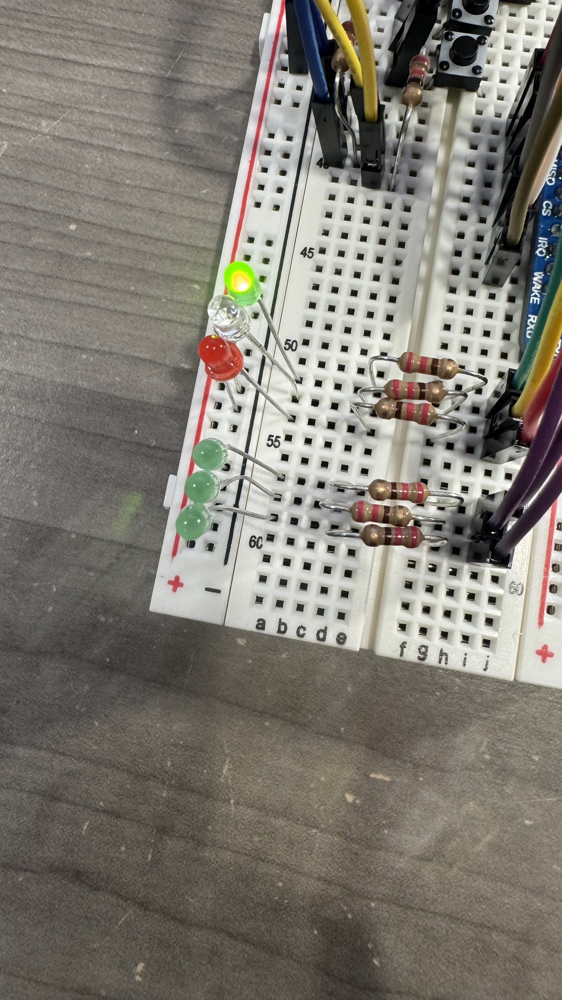
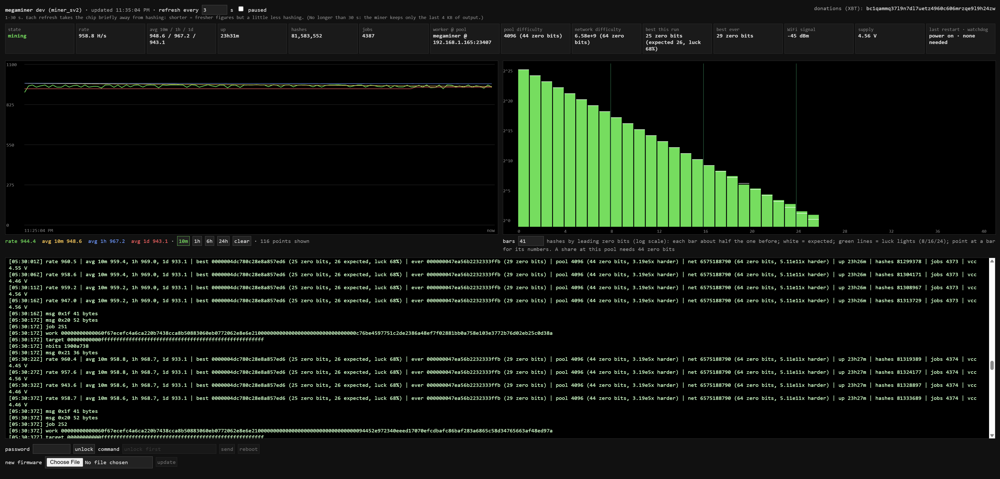

# megaminer manual

How a built megaminer behaves and how to run it: the lights, the start-up
button menu, the console and its commands, the web page, firmware updates,
and what the miner does by itself when something goes wrong. Building one is
in [build.md](build.md).

There are two miner programs, `miner_sv2` (Stratum V2, the default) and
`miner_sv1` (Stratum V1). They behave the same apart from the protocol; where
they differ, this manual says so.

## Contents

- [The lights](#the-lights)
- [Start-up](#start-up)
- [The start-up button menu](#the-start-up-button-menu)
- [The consoles](#the-consoles)
- [Settings](#settings)
- [Commands](#commands)
- [The web page](#the-web-page)
- [Reading the log](#reading-the-log)
- [Firmware updates](#firmware-updates)
- [Looking after itself](#looking-after-itself)
- [What is kept across a restart](#what-is-kept-across-a-restart)

## The lights

<p align="center"><br>
<em>The traffic light showing green (hashing), and the luck bar, dark between rare hashes.</em></p>

Top to bottom as in the wiring diagram:

| Light | Colour | While the miner runs |
|---|---|---|
| Heartbeat | yellow | Breathes slowly (about 2.5 s a breath). It only moves while the program is running normally: a light stuck at one brightness means the program has stopped. |
| Telnet | yellow | On while someone is connected to the network console. |
| Traffic | green | Hashing a live job from the pool. |
| Traffic | yellow | Not hashing, on the way: connecting, making a key, the handshake, or waiting to retry after a failure. |
| Traffic | red | Not hashing, needs you: no WiFi, no SV2 authority key, or three failures in a row. |
| Luck 1-3 | green | A bar that lights for a rare hash (below). |

**The luck bar.** Every hash is a random number; the more zero bits it
starts with, the rarer it is. A hash with 8 or more leading zero bits lights
luck 1 for 0.1 s (about 4 times a second). 16 or more lights luck 1-2 for
2 s (about once a minute). 24 or more lights all three for 60 s (about once
every 4¾ hours). A weaker hash never cuts a stronger one's time short. For
comparison, a share needs at least 32 zero bits.

**Other patterns:**

- **At start-up** every light comes on once, one after another (the lamp
  test), so a dead LED or a wiring mistake shows straight away.
- **In the bootloader** (the start-up menu, or a firmware update) the
  heartbeat blinks fast (0.2 s on, 0.2 s off) instead of breathing. The
  bootloader's other lights are described under
  [Firmware updates](#firmware-updates).
- **In WiFi setup mode** luck 1-2 stay lit; the traffic light blinks yellow
  while waiting for a phone, is steady yellow while trying the new details,
  shows red for 3 s if they did not work, and all six flash three times when
  they worked and were saved.

## Start-up

After power-on or a reset:

1. The bootloader runs first and, unless the button is held or an update is
   pending, starts the miner at once.
2. The miner prints its version and why it last restarted, loads its
   settings, and runs the lamp test.
3. It checks the button menu's choice (below), starts the WiFi module and
   joins the network.
4. It checks its fast hashing routine against the plain BLAKE2b code and
   times it.
5. It asks the time server for the time, connects to the pool and starts
   hashing as soon as the first job arrives.

`miner_sv2` takes a few seconds more before connecting: it makes a fresh
key (4-12 s) and does the encrypted handshake (about 12 s), the traffic
light yellow throughout.

## The start-up button menu

The recovery button is read at start-up, by the bootloader, so the menu
works even when the miner program is broken.

1. Hold the recovery button down.
2. Press and release reset, still holding the recovery button.
3. Watch the luck bar. Every 2 s all three traffic lights flash and the bar
   moves on: 0, 1, 2, 3 lit, then back to 0.
4. Release the button when the bar shows your choice:

| Luck bar | Choice |
|---|---|
| 0 lit | Nothing: start normally. Holding on through a whole cycle also cancels. |
| 1 lit | **Clear the console password.** For when it is forgotten. |
| 2 lit | **WiFi setup mode.** Give the miner a WiFi network from a phone. |
| 3 lit | **Stay in the bootloader** for a firmware update (for when the miner program itself cannot be reached). |

**WiFi setup mode.** The WiFi module opens an open network called
`megaminer-setup`. Join it with a phone: the setup page opens by itself (or
open any web address). Choose the network, type its password and press
Connect. The miner tries the details first and saves them only if they
work; then it carries on starting up. Until it succeeds it stays in setup
mode; a reset leaves without changing anything.

## The consoles

The miner's console is a line-by-line text interface. It is the same on
three connections:

- **Telnet**, port 2323: `telnet <address> 2323`, or PuTTY with connection
  type Telnet. It first shows the output since start-up and the recent
  output, then everything live. Type `quit` to leave.
- **The web page**, port 80: the same output, and a command box (below).
- **Serial**, 250000 baud 8N1, on a USB-serial adapter wired to PD0/PD1.
  This one works without WiFi, and never asks for the console password
  (whoever has the wire has the board).

**The console password** (`console.password`). Over the network, commands
need it; reading the output does not. On telnet, type it on a line of its
own first. On the web page, press "unlock". Without a password set, anyone
on the network can type commands, so set one.

After a wrong password, every password check (telnet and web page) is
refused for 2 s, which makes guessing slow. A telnet visitor is not
disconnected for a wrong password.

The miner's address is in your router's list of connected devices, or in
the `net` command's output.

## Settings

Typed as `name=value` on any console, kept in EEPROM. Nothing changes until
`save`: then only what needs it restarts. A WiFi change restarts the WiFi
module (which drops the telnet and web connections for a few seconds); a
pool change reconnects to the pool; anything else is just stored.

| Setting | What it is |
|---|---|
| `wifi.ssid=NAME` | The WiFi network. Spaces are allowed here. |
| `wifi.password=PASSWORD` | Its password. Empty for an open network. |
| `console.password=PASSWORD` | Needed for commands over the network. Empty: none. |
| `pool.address=a.b.c.d` | The pool's IP address. |
| `pool.port=N` | The pool's port. |
| `pool.worker=NAME` | The name the miner gives the pool. |
| `time_server=a.b.c.d` | An SNTP server's IP address. Gives the log its clock times; `miner_sv2` also needs it to check the pool certificate's dates. |
| `sv2.authority_key=KEY` | `miner_sv2` only: the pool's authority public key, as the pool publishes it (base58) or as 64 hex digits. The miner refuses a pool whose certificate this key did not sign. |
| `sv2.check_cert=0\|1` | `miner_sv2` only: 1 (the default) checks the certificate; 0 skips the check, for testing only. |

`show` lists them. Passwords are never shown, not even their length: only
"(set)" or "(none)".

The Ethernet build (`NET=w5500`) also has `ethernet.ip`, `ethernet.netmask`,
`ethernet.gateway`, `ethernet.mac` and `ethernet.dhcp`.

## Commands

| Command | What it does |
|---|---|
| `help` | The version and a list of commands and settings. |
| `show` | The settings. |
| `save` | Stores the settings and applies them (see above). |
| `defaults` | Restores the built-in settings, except WiFi and the console password (so it cannot cut itself off the network). Not stored until `save`. |
| `net` | The WiFi state: joined or not, the address, the signal strength. |
| `mem` | Free memory, and how close the stack has ever come to the data. |
| `reboot` | Restarts the chip (the WiFi module too). |
| `update` | Restarts into the bootloader to take a new firmware over WiFi (see below). |
| `resetbest` | Forgets the best hash ever; this run's best becomes the record. |
| `resetstats` | Restarts the 10 min / 1 h / 1 day averages from now. |
| `resetrestarts` | Sets the counts of watchdog restarts back to zero. |

## The web page

Open `http://<address>/` in a browser.

[](images/dashboard.png)

It shows:

- **Status:** the state (mining, connecting, retrying, needs you), hash
  rate and averages, uptime, hashes, jobs, worker and pool, the pool's and
  the network's difficulty, the best hash this run and ever (point at it
  for the whole hash), WiFi signal, supply voltage, and restart counts.
- **Hash rate chart:** the rate and the averages over time. The browser
  collects it from the log and keeps it (up to 24 h) in its own storage,
  so it survives a reload in the same browser; nothing is stored on the
  chip. Ranges 10 min, 1 h, 6 h, 24 h; point at the chart for the values at
  that moment.
- **Luck chart:** every hash so far, counted by its leading zero bits, on a
  log scale. Each extra zero bit should halve the count; the chart marks
  that expected staircase and the luck lights' thresholds.
- **Log:** the console output, refreshed every few seconds ("refresh
  every" and "paused" at the top).
- **Commands:** a command box, a reboot button and a firmware upload. With
  a console password set they stay disabled until "unlock"; the page keeps
  the password for that tab only, and "lock" forgets it.

The miner serves two visitors at a time; a third may be told it is busy for
a moment.

## Reading the log

Every line starts with the time: `[05:48:27Z]` (UTC) once the time server
has answered, `[+12s]` (seconds since start-up) before that.

When a job arrives:

```
work 00000000...      the 80-byte block being hashed
target 00000000ff...  the share target: a hash at or below it is a share
nbits 207fffff        the network difficulty as the pool sent it
```

About every 5 s while hashing, one rate line:

```
rate 959.7 | avg 10m 113.8, 1h 11.7, 1d 0.0 | best 00010e23... (15 zero bits, 16 expected, luck 90%)
  | ever 000000047e... (29 zero bits) | pool 1 (32 zero bits, 6.92e4x harder) | up 0h11m
  | hashes 69248 | jobs 5 | vcc 4.48 V
```

| Part | Meaning |
|---|---|
| `rate` | Hashes per second while hashing, over the last ~5 s. |
| `avg 10m, 1h, 1d` | Hashes done over the last 10 minutes, hour and day, divided by the whole time, including time not spent hashing (connecting, handshakes). They read low until that much time has passed since start-up. |
| `best` | The best (lowest) hash this run, its leading zero bits, the zero bits to expect after this many hashes, and luck: around 100% is normal. |
| `ever` | The best hash ever, kept across restarts and power-offs. |
| `pool` | The pool's share difficulty, the zero bits it needs, and how much harder that is than the best hash ever. |
| `up`, `hashes`, `jobs` | Time since start-up, hashes since start-up, jobs received. |
| `vcc` | The supply voltage, as the chip measures it (to about ±10%). |

`SHARE FOUND` and the pool's answer appear when a hash beats the target.

## Firmware updates

After the first flash, new firmware goes over WiFi to the bootloader.

- **From the PC:** `make ota HOST=<address>` builds the miner and sends it.
  It asks for the console password (hidden); `MEGAMINER_PASS` in the
  environment saves typing it. `make ota TARGET=miner_sv1` for SV1.
- **From the web page:** build the `.bin` (`make build/miner_sv2.bin`),
  then choose it next to "update" and press it.

Either way the miner restarts into the bootloader, which joins WiFi with the
saved settings and waits for the image. It checks the console password,
writes the image, reads it back and checks its CRC, then starts it.
Settings, the best hash ever and the restart counts are kept.

**The bootloader's lights:**

| Light | Meaning |
|---|---|
| Heartbeat | Fast blink: in the bootloader. |
| Telnet | WiFi: blinking while joining, steady once joined. |
| The six below it | All dark: waiting for an upload. Filling as a bar from the top while receiving. Full, then all flash three times: written, checked, starting it. |
| Red alone, steady | The last attempt failed (wrong password, bad image, CRC mismatch, cut off). It keeps waiting for another try. |
| Red alone, blinking (telnet dark) | No WiFi settings saved: nothing to join. Use WiFi setup mode first. |

An update cut off midway is safe: the bootloader marks the program
incomplete before it erases anything and never starts an incomplete
program. It stays in the bootloader, waiting for another try, however many
resets or power cuts happen in between. Without an unfinished update, a
reset or 10 minutes without an upload returns to the old program.

When the miner cannot be reached at all, the start-up menu's choice 3 gets
to the bootloader by hand.

## Looking after itself

- **Retries.** A failed connection or handshake is retried after 10 s. The
  traffic light turns red after three failures in a row and goes back to
  green with the next job.
- **Watchdog.** If the program stops for about 8 s, the chip restarts
  itself. The heartbeat light shows the same discipline: it only breathes
  while the program is running.
- **Stuck rule.** If the program is running but has not hashed for 15
  minutes, and is not waiting on something only a person can fix (such as
  WiFi details or an authority key), it restarts the chip, which also
  restarts the WiFi module.
- **Self-check.** At every start-up the fast hashing routine is checked
  against the plain BLAKE2b code. If they ever disagree it says so and uses
  the plain code. Shares are always confirmed with the plain code before
  they are sent.

The start-up output says why the chip last restarted (power-on, reset
button, watchdog, stuck rule, or a `reboot`/`update`), and the web page
counts the watchdog and stuck-rule restarts.

## What is kept across a restart

| Kept | Where |
|---|---|
| Settings | EEPROM; also kept through `make flash` (the EESAVE fuse). |
| The best hash ever | EEPROM (`resetbest` forgets it). |
| Counts of watchdog and stuck-rule restarts | EEPROM (`resetrestarts` clears them). |
| The hash rate chart | In the browser, not on the chip. |
| Everything else (this run's best, averages, the log) | Starts afresh. |
